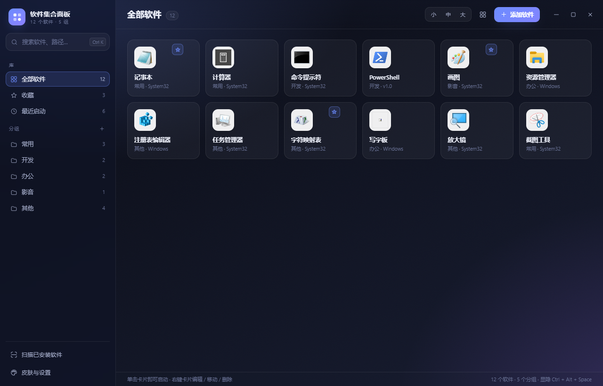

# 软件集合面板

一个用 Electron 写的 Windows「软件集合面板」：把常用软件收进一个漂亮的界面，点一下就启动。已安装的程序可以一键从开始菜单扫描进来，免安装的 `.exe` / `.lnk` / `.url` / `.bat` 直接拖进来即可。**只记录路径，不移动、不卸载任何软件。**



## 功能

- **添加**
  - 一键扫描开始菜单（自动跳过卸载程序、帮助文档、官网链接等噪声，并抓取图标）
  - 扫描结果可导入到指定分组，也可以「自动分组」按类型归入常用 / 开发 / 办公 / 影音 / 其他
  - 手动添加：选择文件，或把 `.exe` / `.lnk` / `.url` / `.bat` / `.cmd` / `.ps1` / `.jar` / `.msc` 直接拖进窗口
  - 自动去重（同一目标 + 参数只保留一条）
- **整理**
  - 拖动卡片排序，拖到左侧分组即可移动分组
  - 右键菜单：启动 / 以管理员身份启动 / 打开所在位置 / 复制路径 / 编辑 / 更换图标 / 收藏 / 移动到分组 / 从面板移除
  - 收藏、最近启动、分组筛选；网格与列表两种视图，三档卡片尺寸
- **启动**
  - 单击卡片启动；支持带参数启动、`.bat` / `.ps1` / `.jar`、网址快捷方式
  - 需要 UAC 的程序可右键「以管理员身份启动」
  - 可设置关闭窗口时最小化到托盘、全局快捷键显隐、开机自启
- **外观**
  - 9 套内置皮肤、8 种强调色（或跟随皮肤）、自定义背景图与叠加浓度
  - 无边框窗口 + 自绘标题栏、卡片悬停动效、可选毛玻璃（Windows 11）
  - 图标优先使用 256px 高清版本（PowerShell 提取，失败自动回退到 32px）

## 直接使用（免安装版）

双击 `dist\软件集合面板-win32-x64\软件集合面板.exe`。

- 配置、图标、皮肤设置都保存在 exe 同级的 `Data\` 目录里，整个文件夹可以直接拷到 U 盘。
- 想改用系统用户目录（`%APPDATA%\SoftwareToolsPanel`）保存配置，删除同级的 `portable.dat` 即可。

## 开发

```bash
npm install
npm start        # 启动
npm run dev      # 启动并打开开发者工具
npm run icon     # 重新生成 build/icon.png 与 build/icon.ico
npm run dist     # 打包免安装目录版到 dist/
```

> 环境要求：Node.js 18+、Windows 10/11。打包脚本直接复制本地 Electron 运行时并用 `resedit` 写入图标与版本信息，无需 electron-builder。

### 自检与截图

```bash
npx electron tools/selftest.js    # 核心逻辑自检（增删改排序、启动、图标、扫描、导入导出）
npx electron tools/devshots.js    # 离屏渲染界面截图到 shots/（使用独立临时数据目录，不影响真实配置）
```

## 快捷键

| 快捷键                     | 功能                 |
| ----------------------- | ------------------ |
| `Ctrl + K` / `Ctrl + F` | 聚焦搜索               |
| `Ctrl + N`              | 添加软件               |
| `Ctrl + ,`              | 皮肤与设置              |
| `Ctrl + B`              | 显示 / 隐藏左侧栏         |
| `Ctrl + Alt + Space`    | 显示 / 隐藏面板（可在设置中修改） |
| `↑ ↓ ← →`               | 在卡片间移动焦点           |
| `Enter` / `Space`       | 启动选中的卡片            |
| `Delete`                | 从面板移除选中的卡片         |
| `Shift + F10` / 菜单键     | 打开右键菜单             |
| `Esc`                   | 关闭弹窗 / 菜单 / 清空搜索   |

## 皮肤

`midnight` 深空夜航 · `graphite` 石墨极简 · `aurora` 极光森林 · `ocean` 深海 · `sakura` 樱花微光 · `frost` 霜白 · `paper` 暖纸 · `cyber` 赛博霓虹 · `gold` 暗夜鎏金

皮肤由 `src/renderer/styles/skins.css` 中的 CSS 变量定义，新增一套只需复制一段 `[data-skin="xxx"]` 并在 `src/renderer/app.js` 的皮肤列表里注册。

## 数据与目录

| 位置                                        | 说明                                |
| ----------------------------------------- | --------------------------------- |
| `%APPDATA%\SoftwareToolsPanel\panel.json` | 非便携模式的配置（分组、软件列表、设置、窗口位置）         |
| `<exe 同级>\Data\`                          | 便携模式的配置与图标（存在 `portable.dat` 时启用） |
| `<userData>\icons\`                       | 提取出的图标 PNG，删除卡片时一并清理              |

设置面板里可以直接「打开数据目录」，也支持导入 / 导出配置 JSON。

## 项目结构

```
src/main/main.js       主进程：窗口、托盘、单实例、全局快捷键、IPC、图标升级调度
src/main/store.js      配置结构 / 持久化 / 图标文件管理
src/main/library.js    开始菜单扫描、快捷方式解析、启动、图标提取
src/main/hires.js      256px 高清图标批量提取（PowerShell + IShellItemImageFactory）
src/preload/preload.js contextBridge 暴露的渲染层 API
src/renderer/          界面（index.html / app.js / styles/app.css / styles/skins.css）
resources/             高清图标提取脚本
tools/                 图标生成、打包、自检、截图脚本
```

## 已知限制

- 开始菜单扫描依赖 `.lnk` / `.url`，UWP 应用和绿色软件不会自动出现，需要手动添加。
- 高清图标通过 PowerShell 调用系统 Shell 接口提取，个别程序可能只有 32px 图标。
- 面板只负责启动，不接管进程；「最近启动」按点击时间记录。

## 💖 赞助

如果这个项目对你有帮助，欢迎请作者喝杯咖啡 ☕

[在爱发电赞助](https://afdian.com/a/yhbsoul)
